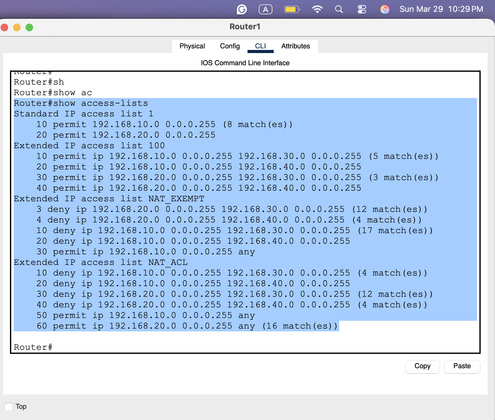
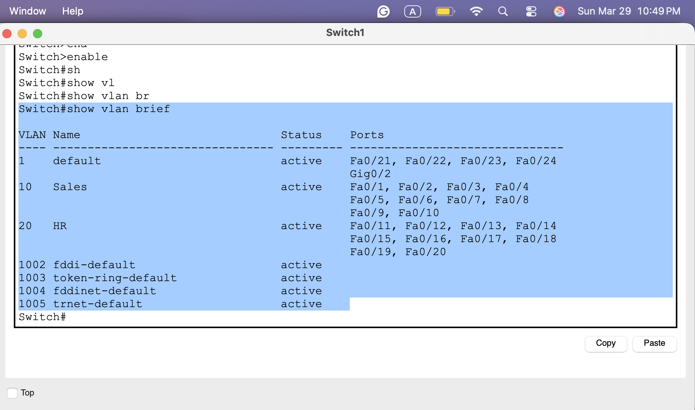

# Enterprise Network, Site-to-Site VPN & SOC Investigation

I designed and built a two-site enterprise network in Cisco Packet Tracer. Departments are separated into VLANs, addresses are assigned by router-hosted DHCP, VLANs are routed with router-on-a-stick, Internet traffic is NATed, and the two offices are linked by an encrypted IPsec site-to-site VPN. I then used the network as the setting for a SOC investigation: suspicious after-hours traffic moving from a Sales workstation to a Finance server across the tunnel. I traced it, classified it, and wrote containment and hardening recommendations.

**Tools:** Cisco Packet Tracer 9.0, Cisco IOS


## Highlights

- Built two sites (San Diego HQ and Phoenix branch) with four department VLANs: Sales, HR, IT, and Finance.
- Configured an **IPsec site-to-site VPN** with ISAKMP phase 1, crypto map `CMAP`, `esp-aes`/`esp-sha-hmac`, and interesting-traffic ACLs, and verified it with active security associations on both routers.
- Implemented **selective encryption**: NAT-exemption ACLs keep inter-office traffic untranslated so it is caught by the tunnel, while Internet traffic is translated with PAT.
- Ran a **SOC investigation** of SMB/RDP/SSH activity across the tunnel. Mapped IP → MAC → switch port with IOS commands, identified the over-permissive VPN ACL as the enabling weakness, and recommended micro-segmentation, IDS, egress filtering, and VPN logging.

## Architecture

```
 Site A – San Diego                                              Site B – Phoenix
 PCs ── Switch1 ── Router1 (ISR 4331) ── Internet Router ── Router2 (ISR 4331) ── Switch2 ── PCs
 VLAN 10 Sales    G0/0/0.10 192.168.10.1                       G0/0/0.30 192.168.30.1   VLAN 30 IT
 VLAN 20 HR       G0/0/0.20 192.168.20.1                       G0/0/0.40 192.168.40.1   VLAN 40 Finance
                  G0/0/1 209.165.200.226 ◄═══ IPsec VPN (CMAP) ═══► G0/0/1 209.165.200.229
```

| Layer | Implementation |
|---|---|
| Segmentation | 802.1Q VLANs; access ports Fa0/1–10 and Fa0/11–20 per switch |
| Addressing | DHCP pools on each router (gateway, mask, DNS 8.8.8.8) |
| Inter-VLAN routing | Router-on-a-stick sub-interfaces |
| Internet access | PAT with NAT-exemption ACLs |
| Site-to-site | IPsec VPN between router WAN interfaces |

Full design notes: [docs/architecture.md](docs/architecture.md).

## Implementation

**VPN tunnel up on both peers.** ISAKMP SAs in `QM_IDLE / ACTIVE` with each router's WAN address as peer.


**Traffic encrypted through the tunnel.** IPsec SAs show packets encapsulated and decapsulated for each subnet pair, for example HR → Finance through crypto map `CMAP`.


**NAT exemption and interesting traffic.** ACL `100` defines the encrypted subnet pairs. The NAT ACLs keep those pairs from being translated and send everything else out with PAT.



**VLANs and DHCP.** Each switch carries its department VLANs, and clients receive their addressing automatically.



Configuration excerpts for every device are in [docs/implementation.md](docs/implementation.md).

## Validation

| Test | Result |
|---|---|
| VLAN membership on both switches | ✅ Verified |
| DHCP leases at both sites | ✅ Verified |
| Inter-VLAN routing (HR → Sales) | ✅ 4/4, TTL 127 |
| IKE phase 1 between sites | ✅ QM_IDLE / ACTIVE on both routers |
| IPsec phase 2 | ✅ Encaps/decaps counters on both routers |
| Cross-site reachability (A → B and B → A) | ✅ 4/4, TTL 126 |
| First packets across a new SA | ⚠️ Initial timeouts while the tunnel negotiated, then replies |


The full test matrix with evidence for each row is in [docs/validation.md](docs/validation.md).

## SOC Investigation

**Scenario:** at 02:15 the SOC flags connections from a Sales workstation (192.168.10.45) to a Finance server (192.168.40.22) on TCP 445, 3389, and 22, all crossing the VPN.

**My analysis:**
- **Classification:** compromised host → internal discovery → attempted lateral movement and exfiltration (SMB for shares/ransomware spread, RDP for GUI control, SSH for admin access).
- **Root cause:** egress filtering failed to stop the initial malware download, and there was no internal access control. The VPN ACL permits every Site A ↔ Site B subnet pair, which I confirmed in my own router configuration.
- **Forensics path:** `show ip dhcp binding` → MAC address → `show mac-address-table` → switch port, plus `show crypto ipsec sa` to confirm the traffic crossed the tunnel.
- **Containment:** shut the suspect switch port immediately, then deploy an ACL denying Sales → Finance.
- **Hardening:** micro-segmentation ACLs, an IDS (Snort/Suricata) on the inside interfaces, egress and web content filtering, and crypto logging to syslog with out-of-hours alerts.

Full write-up: [docs/investigation.md](docs/investigation.md) and the [SOC report](reports/part-b-soc-investigation-report.md).

## Key Takeaways

- **NAT exemption must mirror the crypto ACL exactly.** If NAT rewrites the source first, the traffic no longer matches the interesting-traffic ACL and the tunnel never carries it.
- **Phase 1 and Phase 2 failures look different.** A PSK mismatch stops ISAKMP; a NAT overlap shows up as an SA with zero encapsulated packets.
- **Encryption is not access control.** A VPN that permits every subnet pair protects data in transit, but it also gives an attacker a clean path between sites.

## Next Steps

- Apply and test the Sales → Finance deny ACL recommended in the investigation.
- Add `show running-config` exports so the full configuration is reviewable without Packet Tracer.
- Extend the design with Cisco ASA firewalls at each site and the VLAN 50 (Engineering) expansion.

## Repository Guide

| Path | Contents |
|---|---|
| [`reports/`](reports/) | [Network design report](reports/part-a-network-design-report.md) and [SOC investigation report](reports/part-b-soc-investigation-report.md) |
| [`docs/architecture.md`](docs/architecture.md) | Requirements, topology, addressing |
| [`docs/implementation.md`](docs/implementation.md) | VLAN, DHCP, ACL, and IPsec configuration (transcribed from device output) |
| [`docs/validation.md`](docs/validation.md) | Test matrix with evidence |
| [`docs/investigation.md`](docs/investigation.md) | SOC analysis and evidence chain |
| [`docs/evidence-index.md`](docs/evidence-index.md) | Every claim mapped to its screenshot |
| [`labs/`](labs/) | Packet Tracer simulation (available on request) |

---

© 2026 Ghazal Mahdian. Company names and incident data are fictional scenarios used for the project.
