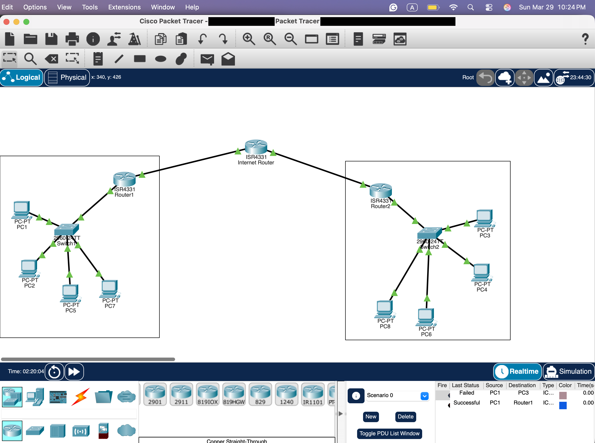
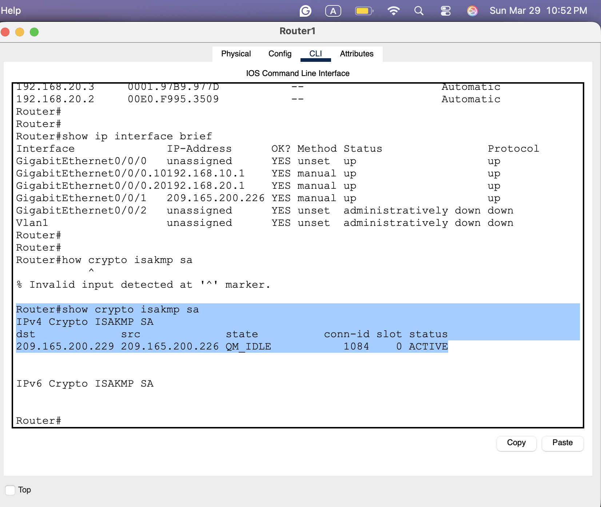
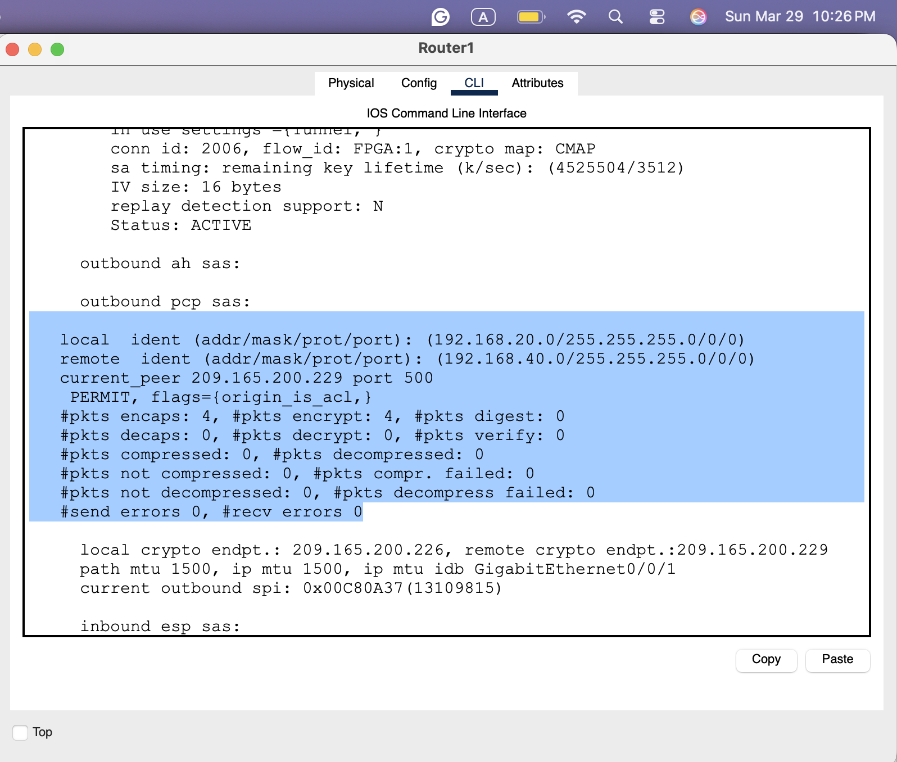
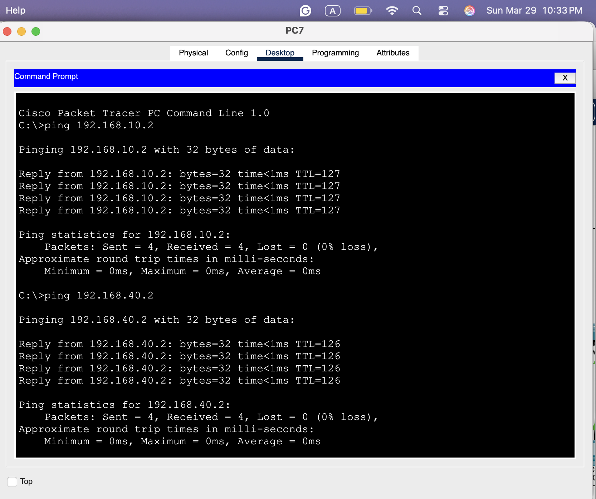

# Enterprise Network, Site-to-Site VPN, and SOC Investigation Lab

A two-part Cisco Packet Tracer lab from a graduate information assurance course (CYB555, midterm). Part A builds a two-site network with VLANs, router-based DHCP, router-on-a-stick inter-VLAN routing, NAT, and an IPsec site-to-site VPN. Part B uses that network as the setting for a simulated SOC investigation into suspicious cross-site traffic.

This repository documents the lab as a case study. It contains web versions of my two reports (with the instructor's questions paraphrased) and selected screenshots. It does not contain exported device configurations, so some details are described from screenshots rather than from configuration files.

> **Scope note.** The company (BrightFuture Technologies), the incident, and the sample log in Part B are instructor-provided teaching scenarios. They are not real organizations or real security events.

## At a glance

| | |
|---|---|
| Context | CYB555 midterm, Parts A and B (screenshots dated 29 March 2026) |
| Environment | Cisco Packet Tracer (save path in screenshots references a "Cisco Packet Tracer 9.0.0" folder) |
| Sites | Site A "San Diego" (Sales VLAN 10, HR VLAN 20); Site B "Phoenix" (IT VLAN 30, Finance VLAN 40) |
| Strongest evidence | `show crypto isakmp sa` on both routers (QM_IDLE / ACTIVE), `show crypto ipsec sa` packet counters, DHCP bindings, VLAN tables, cross-site pings |
| Main gap vs. assignment | The assignment specified Cisco ASA 5506-X firewalls terminating the VPN. The submitted lab terminates the VPN on ISR 4331 routers; no ASA appears in the topology. |

## Business problem and lab context

The scenario describes a consulting firm with two offices that exchange files by email. The assignment asked students to segment departments, automate addressing, route between VLANs, protect each site, and connect the sites with an encrypted tunnel while leaving Internet-bound traffic unencrypted. Part B then asks students to act as SOC analysts investigating 02:15 AM traffic from a Sales workstation (192.168.10.45) to a Finance server (192.168.40.22) on TCP 445, 3389, and 22 across the VPN.

The full assignment text is not republished here. [docs/architecture.md](docs/architecture.md) summarizes the requirements alongside what was built.

## My contribution

The supplied materials show the following work:

- A Packet Tracer topology with two ISR 4331 site routers, an ISR 4331 "Internet Router", two Layer 2 switches, and eight PCs ([topology screenshot](assets/screenshots/topology-two-site-ipsec-packet-tracer.png)).
- VLAN, DHCP, sub-interface, NAT/NAT-exemption, and IPsec configuration, evidenced by `show` command output on both routers and both switches.
- A Part A design explanation with answers to the case-study questions ([report](reports/part-a-network-design-report.md)).
- A Part B SOC investigation report with an attack narrative, an evidence chain, and hardening recommendations ([report](reports/part-b-soc-investigation-report.md)).

All work in this repository, both the lab build and the two reports, was done individually.

## Tools and technologies evidenced

- Cisco Packet Tracer; ISR 4331 routers; 2960-series switches (labels visible in topology)
- IEEE 802.1Q VLANs and router-on-a-stick sub-interfaces (`GigabitEthernet0/0/0.10`, `.20`, `.30`, `.40`)
- Router-hosted DHCP pools (bindings on both routers; clients receive gateway and DNS 8.8.8.8)
- IPsec site-to-site VPN: ISAKMP phase 1, crypto map `CMAP`, transform `esp-aes esp-sha-hmac`, interesting-traffic ACL `100`
- NAT with exemption ACLs (`NAT_EXEMPT`, `NAT_ACL`, standard ACL `1`)
- IOS verification commands: `show vlan brief`, `show ip dhcp binding`, `show ip interface brief`, `show access-lists`, `show crypto isakmp sa`, `show crypto ipsec sa`

Not evidenced: Cisco ASA, firewall policy, IDS, syslog, or any real traffic capture.

## Architecture overview

```
 Site A (San Diego)                                             Site B (Phoenix)
 PCs ── Switch1 ── Router1 (ISR 4331) ── Internet Router ── Router2 (ISR 4331) ── Switch2 ── PCs
 VLAN 10 Sales    G0/0/0.10 192.168.10.1   (ISR 4331)        G0/0/0.30 192.168.30.1   VLAN 30 IT
 VLAN 20 HR       G0/0/0.20 192.168.20.1                     G0/0/0.40 192.168.40.1   VLAN 40 Finance
                  G0/0/1 209.165.200.226 ◄═══ IPsec (CMAP) ═══► G0/0/1 209.165.200.229
```

Addresses are taken from `show ip interface brief` on each router. Details and requirement mapping are in [docs/architecture.md](docs/architecture.md).


*Packet Tracer logical topology: Router1/Router2 and the Internet Router are ISR 4331s; each site has one switch and four PCs. The PDU list shows one failed PC1→PC3 test and one successful PC1→Router1 test. The file path in the title bar has been redacted.*

## Implementation highlights

- **Segmentation and addressing.** Switch1 places Fa0/1–10 in VLAN 10 (Sales) and Fa0/11–20 in VLAN 20 (HR). Switch2 does the same for VLAN 30 (IT) and VLAN 40 (Finance). Each router serves DHCP for its two VLANs.
- **Selective encryption.** ACL `100` on Router1 defines all four Site A↔Site B subnet pairs as interesting traffic, and Router2 holds the mirror image. NAT exemption ACLs deny those same pairs from translation and permit the local subnets to `any`. This matches the requirement to encrypt inter-office traffic while Internet traffic is translated in the clear.
- **Tunnel establishment.** Both routers report an ISAKMP SA in `QM_IDLE` / `ACTIVE` state with each other's WAN address as peer, and IPsec SAs carry non-zero encapsulation and decapsulation counters.

Configuration excerpts transcribed from screenshots are in [docs/implementation.md](docs/implementation.md).


*Router1: `show crypto isakmp sa` shows dst 209.165.200.229, src 209.165.200.226, state QM_IDLE, status ACTIVE. An earlier mistyped command (`how crypto isakmp sa`) is visible above it.*


*Router1: the IPsec SA for 192.168.20.0/24 → 192.168.40.0/24 shows 4 packets encapsulated and 0 decapsulated at the time of capture, using crypto map CMAP.*


*PC7 (HR, Site A) reaches 192.168.10.2 in Sales (TTL 127, one routed hop) and 192.168.40.2 in Finance at Site B (TTL 126), both with 0% loss.*

## Validation summary

| Area | Status |
|---|---|
| VLANs on both switches | Demonstrated |
| DHCP leases on both sites | Demonstrated |
| Inter-VLAN routing (Site A) | Demonstrated |
| ISAKMP/IPsec SAs between sites | Demonstrated |
| Cross-site pings | Demonstrated, with initial packet loss in one capture |
| Internet traffic NATed and not encrypted | Configured (NAT ACLs visible); no Internet test captured |
| ASA firewall protection | Not implemented in the submitted lab |
| Part B evidence chain (MAC → switch port Fa0/5) | Reported in write-up; not supported by the screenshots supplied |

The complete table, including partial results, is in [docs/validation.md](docs/validation.md).

## SOC investigation (Part B)

The Part B report classifies the activity as a compromised host followed by internal discovery and attempted lateral movement. It identifies the open VPN crypto ACL and the absence of inter-department ACLs as the failed controls. It recommends Sales→Finance ACLs, an IDS on inside interfaces, egress filtering, and VPN logging to syslog.

The lab could only partly reproduce the scenario. The suspect address 192.168.10.45 does not exist in the lab (DHCP issued 192.168.10.2 and .3), so the report's DHCP and VPN screenshots use existing lab hosts as stand-ins. The report also states that the MAC address was traced to Switch1 port Fa0/5. The MAC-table screenshot in the report comes from a Site B switch and does not show that MAC or that port. [docs/investigation.md](docs/investigation.md) covers the analysis and these discrepancies.

## Limitations and missing artifacts

- No `show running-config` output or exported configs. Pre-shared key, ISAKMP policy (encryption, hash, DH group, lifetime), NAT statements, and trunk configuration are not visible in any supplied screenshot.
- The Packet Tracer file is not published because it contains the VPN pre-shared key and device passwords (see [labs/README.md](labs/README.md)).
- The Part A report says AES-256. The screenshots show `esp-aes` without a key length, so AES-256 is not confirmed.
- Switch trunk status (`show interfaces trunk`) was not captured.
- In the Part B report, question 13 ("What information can DHCP logs provide?") has no written answer (p. 3).
- The ASA requirement was not met; the lab used routers for VPN termination.

## Lessons learned

**From the reports:**
- NAT exemption must match the crypto ACL exactly. If NAT translates the source first, the interesting-traffic ACL no longer matches and the tunnel does not form or pass data (Part A, p. 3).
- Phase 1 and Phase 2 failures look different: a PSK mismatch stops ISAKMP, while a NAT overlap shows up as an SA with zero encapsulated packets (Part A, p. 4).
- A site-to-site VPN that permits every subnet pair extends the attack surface between sites. Encryption protects confidentiality in transit, not access control (Part B, pp. 7–8).


## Reviewing this repository

1. Start with this README, then [docs/validation.md](docs/validation.md) for what was and was not shown.
2. Use [docs/evidence-index.md](docs/evidence-index.md) to trace any claim to a screenshot or report page.
3. Read the reports in `reports/`; they render directly on GitHub. `[p. N]` markers refer to the original PDF pages cited in the docs.
4. The Packet Tracer simulation is available on request; see [labs/README.md](labs/README.md).

## Repository contents

```
README.md
docs/
  architecture.md      requirements vs. built design, addressing
  implementation.md    transcribed configuration excerpts and evidence
  validation.md        test table with status
  investigation.md     Part B SOC analysis and discrepancies
  evidence-index.md    claim → file/page mapping, excluded originals
reports/               Part A and Part B reports (web versions, questions paraphrased)
labs/                  note on the Packet Tracer file (not published)
assets/screenshots/    selected, renamed, redacted screenshots
```

## Use and licensing

No license is applied. The assignment scenario belongs to the course instructor, and my reports and screenshots are shared for portfolio review only. Contact the author before reusing any material.
