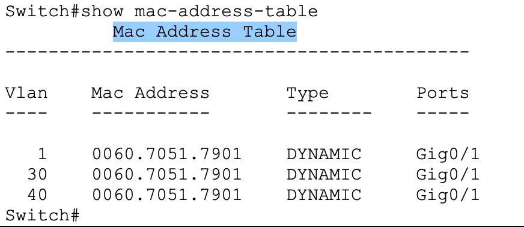

# SOC Investigation (Part B)

> The incident, the sample log, the company, and the IP addresses 192.168.10.45 and 192.168.40.22 come from an instructor-written teaching scenario. Nothing here describes a real event.

## Scenario (summary)

At 02:15 the scenario's monitoring system flags repeated connections across the site-to-site VPN from a Sales workstation (192.168.10.45, VLAN 10, Site A) to a Finance server (192.168.40.22, VLAN 40, Site B). The supplied sample log shows three allowed TCP connections about a minute apart:

| Time | Source | Destination | Port | Service |
|---|---|---|---|---|
| 02:15:22 | 192.168.10.45 | 192.168.40.22 | 445 | SMB |
| 02:16:10 | 192.168.10.45 | 192.168.40.22 | 3389 | RDP |
| 02:17:03 | 192.168.10.45 | 192.168.40.22 | 22 | SSH |

A follow-up in the scenario reveals that the workstation had downloaded malware from an external site.

## Analysis in the submitted report

**Initial triage (pp. 1–2).** The report places the source in VLAN 10 (Sales) and the target in Finance at Site B. It describes the pattern as service port scanning and notes that VPN encryption hides payloads from inspection.

**Network forensics (p. 1).** Port 445 is mapped to SMB (file sharing, a common ransomware path), 3389 to RDP, and 22 to SSH. The report treats the time of day and the cross-department direction as the main indicators: a Sales workstation has no business reason to open SSH to a Finance server at 02:15.

**VPN and DHCP (pp. 2–3).** The report identifies the tunnel as a site-to-site IPsec VPN with IKE phase 1 and IPsec phase 2. It proposes `show crypto ipsec sa` to confirm traffic crossed the tunnel, and a DHCP binding → MAC address → switch MAC table lookup to find the physical port.

**Containment and improvements (pp. 3–4).** It proposes shutting the switch port for the fastest isolation, an ACL denying Sales → Finance, IDS placement before traffic enters the tunnel, and pattern-based monitoring of encrypted VPN traffic (volume spikes, connection rates).

**Conclusions (pp. 4, 7–8).**

- Attack type: infection followed by lateral movement and attempted data exfiltration.
- Failed controls: egress filtering (the malware download) and internal access control (no path restriction between Sales and Finance).
- The report connects the second failure to the lab configuration: "The Site-to-Site VPN was setup to allow all communication between Site A and Site B subnets" (p. 7). The crypto ACL `100` captured on Router1 supports this. It permits all four Site A ↔ Site B subnet pairs, including 192.168.10.0/24 ↔ 192.168.40.0/24.
- Recommendations: micro-segmentation ACL on Router1 (deny 192.168.10.0 → 192.168.40.0), IDS such as Snort or Suricata on inside interfaces, egress/web content filtering, and crypto logging to a syslog server with out-of-hours alerts (p. 8).

## Evidence chain: what the screenshots support

The report's evidence chain (p. 7) has three links. Only the third is clearly supported.

| Report claim | Supporting evidence | Assessment |
|---|---|---|
| "Show IP DHCP Binding: Linked the suspect IP to MAC 00E0.F787.7708." | Router1 DHCP bindings show 00E0.F787.7708 leased to a lab host. In `router1-dhcp-bindings-and-interfaces.png` it is 192.168.10.3; in the image embedded on report p. 6 it is 192.168.10.2. | The scenario IP 192.168.10.45 is not in the lab. The report used a real lab host as a stand-in but does not say so. |
| "Show mac-address-table: Traced the MAC address to Switch 1, Port Fa0/5." | The only MAC table in the report (p. 3, reproduced as `report-b-mac-address-table-excerpt.png`) lists one MAC, 0060.7051.7901, learned on Gig0/1 in VLANs 1, 30, and 40. VLANs 30/40 are Site B, so this is likely Switch2, and the MAC is most likely the router's trunk-facing interface. | Not supported. Neither the MAC 00E0.F787.7708 nor Fa0/5 appears. |
| "Show crypto ipsec sa confirms successful encapsulation and decapsulation of malicious TCP traffic across the VPN channel." | Router1 SA 192.168.10.0 → 192.168.40.0 shows 3 encapsulated / 3 decapsulated (report p. 6); Router2 shows the mirror (p. 2). | Supported as evidence that lab traffic between those subnets crossed the tunnel. The counters cannot show that the traffic was malicious, or that it was TCP 445/3389/22. ICMP pings were the only test traffic captured. |

*Image extracted from Part B report p. 3. It shows `show mac-address-table` on a switch with VLANs 1, 30, and 40, all pointing to the same MAC on Gig0/1. The traced host MAC and port Fa0/5 do not appear.*

## Interpretation notes

These are reviewer notes, labelled for the author to accept or edit.

- The analysis of ports, attacker goals, and controls fits the scenario. The strongest technical link is between the scenario and the student's own configuration: the permissive crypto ACL is visible evidence of the "open VPN" weakness the report describes.
- Three outbound connections spread over about two minutes is a thin basis for calling this a "scan". The scenario says "high number of connection attempts", but the log shows only three. A reviewer may ask about that framing.
- The recommended Sales → Finance deny ACL was proposed but not applied. A follow-up capture showing a ping from a Sales PC to a Finance PC failing after the ACL change would turn the recommendation into a demonstrated control.
