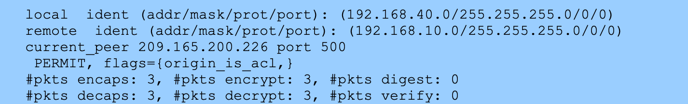
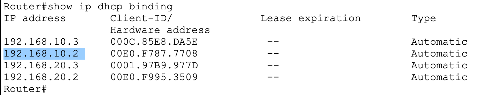
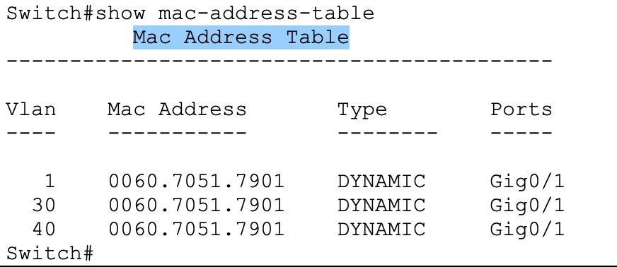
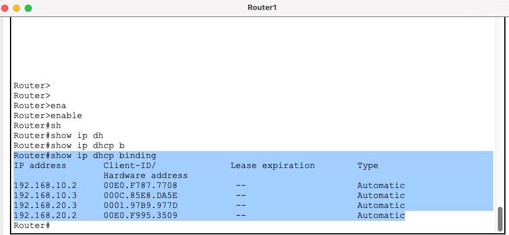
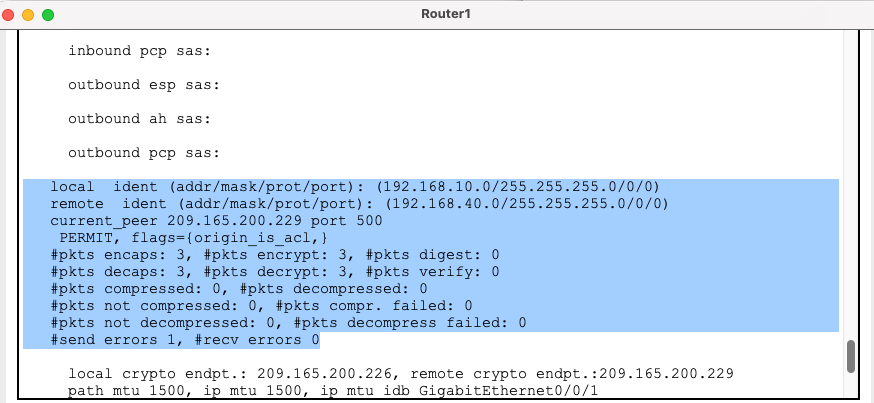

# Part B: SOC Investigation Report

*Author: Ghazal Mahdian (individual work). CYB555 midterm, Part B.*

> **About this version.** This is a web version of the submitted Part B report. The instructor's questions are **paraphrased** as short prompts, and the answers keep the original wording. `[p. N]` markers give the page numbers of the original PDF, which is kept privately and not published. The scenario (a Sales PC at 192.168.10.45 contacting a Finance server at 192.168.40.22 at 02:15 over SMB, RDP, and SSH) is a teaching exercise, not a real incident. Evidence notes that compare the report with the lab screenshots are in [docs/investigation.md](../docs/investigation.md).

---

## Question answers

### Part 1: Initial analysis `[p. 1]`

1. **Source VLAN of the suspicious traffic.** VLAN 10
2. **Department being targeted.** Finance at site B
3. **Why VPN traffic is harder to inspect.** Because it is encrypted
4. **Attack type suggested by probing ports 22, 445, and 3389.** Service Port Scanning; attacker is trying to find open doors for exploitation.

### Part 2: Network forensics `[p. 1]`

5. **Meaning of TCP 445.** SMB (Server Message Block). This is used for Windows file sharing and is a primary target for ransomware.
6. **Service on TCP 3389.** RDP (Remote Desktop Protocol).
7. **Attacker's interest in these services.** To achieve Lateral Movement. By accessing SMB, they can steal files; by accessing RDP, they can take full GUI control of the Finance server.
8. **Indicators of a compromised workstation.** The timestamp (02:15 AM) and the source (Sales PC reaching out to a Finance Server). There is no business reason for a Sales workstation to use SSH (Port 22) on a Finance server in the middle of the night.

### Part 3: VPN security analysis `[p. 2]`

9. **VPN type between the sites.** Site-to-Site IPsec VPN
10. **Phases used to build the tunnel.** Phase 1 (ISAKMP/IKE): authenticates peers and sets up a secure management channel. Phase 2 (IPsec): negotiates encryption for the actual data (the "Interesting Traffic").
11. **Router command to check VPN status.** `show crypto ipsec sa` shows if the malicious packets were successfully encrypted/decapsulated.

*Router2: IPsec SA 192.168.40.0/24 → 192.168.10.0/24, peer 209.165.200.226, 3 packets encapsulated and 3 decapsulated.*

### Part 4: DHCP investigation `[pp. 2–3]`

12. **Value of DHCP data in an investigation.** DHCP logs link a logical IP address to a physical MAC address.
13. **Information available from DHCP logs.** *(Not answered in the submitted report.)*
14. **Finding the physical device behind an IP address.** `[p. 3]` By taking the MAC address from `show ip dhcp binding`, an investigator can look at the switch's MAC-address table (`show mac-address-table`) to find exactly which physical port that device is plugged into.

*Router1 DHCP bindings as captured on report p. 2.*

*`show mac-address-table` as captured on report p. 3 (a switch with VLANs 1, 30, and 40).*

### Part 5: Containment `[p. 3]`

15. **Fastest isolation step.** Shut down the switch port connected to the Sales PC (192.168.10.45).
16. **Control to stop Sales reaching Finance.** Implementing Access Control Lists (ACLs) on the Router/Firewall. Specifically, an ACL that permits Sales to reach the Internet but denies Sales traffic destined for the Finance VLAN.

### Part 6: Security improvements `[p. 4]`

1. **Why restrict access between departments.** To implement Zero Trust and Micro-segmentation. Sales has no "need to know" or "need to access" Finance data.
2. **How an IDS would help.** An IDS placed inside the network (before the traffic is encrypted by the VPN) would recognize the signature of a port scan and alert the SOC immediately.
3. **Why monitor encrypted VPN traffic.** To look for Traffic Patterns. Even if you can't see the data, a sudden spike in data volume (Exfiltration) or high-frequency connection attempts (Brute force) indicates a problem.

### Advanced analysis `[p. 4]`

4. **Attack classification.** Infection followed by Lateral Movement / Data Exfiltration.
5. **Controls that failed.** Egress Filtering (the PC shouldn't have been able to download malware from a malicious site) and Internal Access Control (Sales shouldn't have had a path to Finance).
6. **Preventive policies.** Implement VLAN ACLs (VACLs) and a Web Content Filter to block known malicious domains.

---

## Deliverable screenshots `[pp. 5–6]`

- **VLAN:** `show vlan brief` on each switch. See [Switch1](../assets/screenshots/switch1-site-a-show-vlan-brief.png) and [Switch2](../assets/screenshots/switch2-site-b-show-vlan-brief.png); the report used the same captures.
- **DHCP:** `show ip dhcp binding` on Router 1.

- **VPN:** `show crypto ipsec sa` on Router 1.

*Router1: IPsec SA 192.168.10.0/24 → 192.168.40.0/24, 3 encapsulated / 3 decapsulated, 1 send error.*

---

## 1. SOC investigation report `[p. 7]`

At 02:15 AM, the SOC identified an unlawful lateral movement from the Sales Department (VLAN 10) to a Finance Server (VLAN 40) in the Phoenix branch. The activity involved scanning high-value ports (445, 3389, and 22) using the encrypted Site-to-Site VPN connection.

**Technical findings**

- Source host is 192.168.10.45 (Sales Workstation).
- Target host is 192.168.40.22 (Finance Server).
- Evidence chain:
  - `show ip dhcp binding`: linked the suspect IP to MAC 00E0.F787.7708.
  - `show mac-address-table`: traced the MAC address to Switch 1, Port Fa0/5.
  - `show crypto ipsec sa` confirms successful encapsulation and decapsulation of malicious TCP traffic across the VPN channel.

> **Evidence note.** 192.168.10.45 does not exist in the lab. MAC 00E0.F787.7708 belongs to a lab host used as a stand-in, and the MAC-table capture does not show Fa0/5. See [docs/investigation.md](../docs/investigation.md#evidence-chain-what-the-screenshots-support).

## 2. Explanation of the attack scenario `[pp. 7–8]`

The attack is a prime example of Compromised Host to Lateral Movement.

1. **Initial access:** A workstation in the Sales department (VLAN 10) was likely infected via a phishing link or drive-by download earlier that day.
2. **Internal discovery:** At 02:15 AM, the attacker conducted a "sweep" of the internal network.
3. **Exploiting the VPN:** The Site-to-Site VPN was set up to allow all communication between Site A and Site B subnets, allowing the attacker to bypass "Internet Router" security and directly access Phoenix Finance servers.
4. **Targeted services:** Port 445 (SMB) is being used to spread ransomware by searching for network shares. RDP on port 3389 is an attempt to establish GUI access to the Finance server. `[p. 8]` Port 22 (SSH) is an attempt to get command-line access to administrative accounts.

## 3. Recommended network security improvements `[p. 8]`

Based on this breach, the following hardening measures are necessary to prevent a recurrence:

**A. Implement micro-segmentation using ACLs.** Currently, the VPN is too "open." ACLs need to go on the site routers.
- *Action:* Create an ACL on Router 1 that explicitly denies any traffic from 192.168.10.0 (Sales) to 192.168.40.0 (Finance).
- *Benefit:* Even if a Sales PC is hacked, the router will block any packets trying to access sensitive Finance data.

**B. Deploy an Intrusion Detection System (IDS).**
- *Action:* Install an IDS (like Snort or Suricata) at the "Inside" interface of both routers.
- *Benefit:* The IDS can detect the "signature" of a port scan (multiple connection attempts to different ports within seconds) and alert the SOC before the attacker finds an open door.

**C. Egress filtering.**
- *Action:* Limit what internal PCs can download from the internet.
- *Benefit:* This prevents the "Initial Access" phase by stopping malware downloads at the source.

**D. VPN monitoring and alerting.**
- *Action:* Turn on crypto logging and send logs to a Syslog server.
- *Benefit:* The SOC will get a real-time alert whenever the VPN tunnel is used outside business hours for large data transfers.

---

## Editorial changes

1. Question wording replaced by paraphrased prompts.
2. Light formatting only (bullets, bold labels, command formatting). "setup" corrected to "set up"; "We must put ACLs…" changed to "ACLs need to go…" to reflect individual work. Two sentences in item 4 of section 2 were reordered so each port has its own sentence.
3. Report images are reproduced from the original PDF. VLAN images that duplicate screenshots already in the repository link to those files instead.
4. Evidence notes (quoted blocks) were added; they are not part of the original report.
